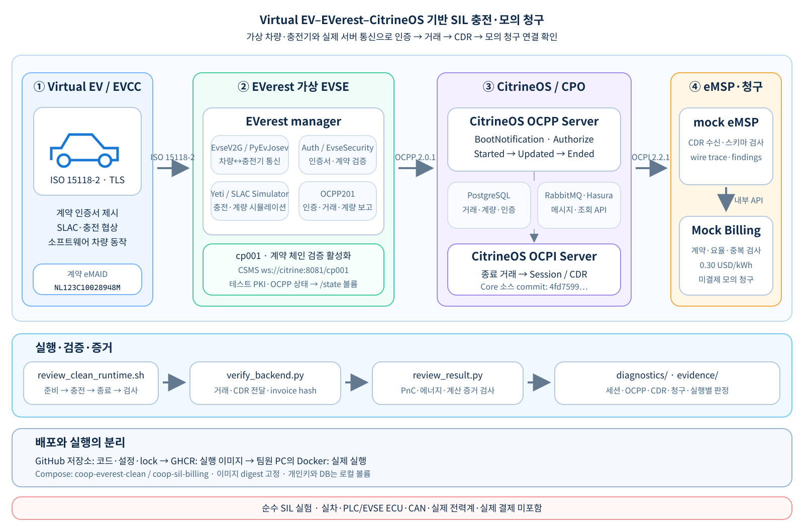

# Coop_Project — SIL 충전·인증·모의 청구 실험 환경

가상 차량과 충전기 소프트웨어를 실행해 **PnC 인증 → 충전 거래 → OCPI CDR 전달 → 고객용 모의 청구**가 같은 거래로 이어지는지 관찰합니다.

[공개 Docker 이미지](https://github.com/junseng12/Coop_Project/pkgs/container/coop-everest-runtime) · [이미지 digest](IMAGES.lock.json) · [배포 CI](https://github.com/junseng12/Coop_Project/actions/runs/43838732712) · [실제 검증 범위](docs/PUBLIC_VALIDATION.json)



*사용자 제공 구조도를 바탕으로 현재 공개 배포 구성을 반영한 도식입니다. [확대 가능한 SVG 원본](docs/assets/sil-architecture.svg). 현재 실행기는 `review_clean_runtime.sh`, EVerest Compose 프로젝트는 `coop-everest-clean`입니다.*

## 1. 이 환경에서 검증하는 경로

```text
Virtual EV ↔ EVerest
             │ OCPP 2.0.1
             ▼
          CitrineOS
             │ OCPI 2.2.1 CDR
             ▼
          mock eMSP
             │ 수신 CDR 상태를 내부 API로 조회
             ▼
         Mock Billing
```

| 구간·기준 | 설정·의미 |
|---|---|
| 차량 ↔ 충전기 | ISO 15118-2, TLS, 실험용 PnC 인증서 |
| 충전기 ↔ 관리 서버 | OCPP 2.0.1, `ws://citrine:8081/cp001` |
| 사업자 간 충전 명세 전달 | CitrineOS OCPI → mock eMSP, OCPI 2.2.1 |
| 충전기 ID | `cp001` |
| 계약 eMAID | `NL123C10028948M` |
| 계약 체인 검증 | `verify_contract_cert_chain: true` |
| 고객용 실험 요율 | 이번 USD 경로는 `0.30 USD/kWh` |
| 청구 결과 | `SIMULATED_INVOICE_NOT_PAID`, 실제 결제 시도 없음 |

CitrineOS 제품 버전 **2.1.0**과 OCPP 프로토콜 **2.0.1**은 다른 숫자입니다. 차량↔충전기의 TLS와 현재 `ws://` OCPP 구간도 구분합니다. 실제 차량·PLC/EVSE ECU·CAN·실제 전력계·생산 PKI·Stripe 결제는 포함하지 않습니다.

## 2. 코드와 Docker 이미지는 왜 나뉘는가

| GitHub 서비스 | 주소·위치 | 저장하는 것 |
|---|---|---|
| **Git 저장소** | `github.com/junseng12/Coop_Project` | 코드·Compose·설정·문서·빌드 방법 |
| **GitHub Container Registry(GHCR)** | `ghcr.io/junseng12/coop-everest-runtime` | 미리 빌드한 실행 이미지 |
| **GitHub Actions** | 저장소의 Actions 탭 | 코드 검사·이미지 빌드·레이어 검사·GHCR 업로드 |

용량뿐 아니라 관리 목적이 다릅니다. Git은 코드 변경 이력을 관리하고, GHCR은 Docker가 실행할 이미지 레이어를 저장·배포합니다. GHCR은 Docker Hub와 비슷한 역할을 하는 **GitHub의 이미지 저장 서비스**입니다. 별도 Docker Hub 계정은 필요하지 않습니다.

```text
git clone             → 코드·설정·IMAGES.lock.json을 받음
clean_everest.sh pull  → lock에 적힌 digest로 GHCR 이미지를 받음
clean_everest.sh up    → 내 PC의 Docker에서 컨테이너 실행
첫 실행               → 내 PC의 볼륨에 테스트 인증서·상태 생성
```

실험은 GitHub 서버에서 상시 실행되는 것이 아닙니다. 공개 이미지는 로그인 없이 받을 수 있고, `IMAGES.lock.json`에 고정한 digest로 같은 배포본을 선택합니다. `git pull`만으로 실행 중인 컨테이너가 자동 교체되지는 않습니다.

Git clone이나 ZIP에는 이미지·DB 볼륨·개인키가 포함되지 않습니다. EVerest 이미지는 GHCR에서 받고, 백엔드는 고정 소스의 빌드·migration·seed로 준비하며, 테스트 인증서는 각 환경에서 생성합니다. 현재 lock은 EVerest runtime을 고정하며 모든 외부 의존성이 완전히 고정됐다는 뜻은 아닙니다.

근거: [GHCR 공식 문서](https://docs.github.com/en/packages/working-with-a-github-packages-registry/working-with-the-container-registry).

## 3. 실험 준비

필수: Linux/Ubuntu WSL2, Git, Python 3, Docker Engine과 Compose 플러그인. 현재 실행 검증 플랫폼은 **Linux amd64**입니다. Docker bridge IPv6와 충분한 메모리·디스크 여유가 필요합니다.

### 처음 받는 동료

```bash
git clone https://github.com/junseng12/Coop_Project.git
cd Coop_Project
bash scripts/bootstrap_public.sh
```

- `.env` 준비 → CitrineOS 고정 소스 준비 → 백엔드 빌드·기동 → 새 DB의 초기 seed → GHCR 이미지 다운로드 → EVerest 기동 순서입니다.
- 기존 DB 볼륨이 있으면 자동으로 재seed하지 않습니다.
- 같은 `cp001`로 다른 manager가 실행 중이면 해당 실험을 종료하고 manager를 중지해야 합니다. 기존 컨테이너·DB는 삭제하지 않습니다.
- **배포 이미지의 다운로드·PnC·청구 연결은 검증했습니다. 다른 PC에서 백엔드까지 포함한 전체 신규 설치 검증은 아직 완료하지 않았습니다.** [검증 기록](docs/PUBLIC_VALIDATION.json)을 확인하세요.

### 이미 구성한 환경을 다시 시작

```bash
bash scripts/stack.sh ps
bash scripts/clean_everest.sh up
bash scripts/clean_everest.sh status
```

백엔드를 중지해 두었다면 준비 후 한 번 실행합니다. `stack.sh up`은 빌드도 수행할 수 있습니다. 매 실험마다 실행할 필요는 없습니다.

```bash
bash scripts/stack.sh up
```

## 4. 변조 전에 정상 기준 확보

공개 저장소 폴더에서 다음을 실행합니다. 특정 사용자의 `/home/...` 경로는 사용하지 않습니다.

```bash
bash scripts/review_clean_runtime.sh
```

이 명령은 기본 약 45초의 새 충전 세션을 실행하고 종료·전달·모의 청구·별도 PnC 증거를 검사합니다. 충전 시간을 바꾸려면:

```bash
REVIEW_CHARGE_SECONDS=60 bash scripts/review_clean_runtime.sh
```

VS Code와 분리 실행하려면 `systemd-run --user`가 동작하는 환경에서 사용합니다.

```bash
bash scripts/detached.sh bash scripts/review_clean_runtime.sh
```

최종 정상 로그 예시:

```text
DATA_CHAIN_OBSERVED | PnC authentication: NOT VERIFIED
...
Clean runtime E2E passed. Result: .../diagnostics/clean-review-<UTC>/result.html
```

`NOT VERIFIED`는 `verify_backend.py` 단독의 검사 범위 표시입니다. 뒤에 실행되는 `review_result.py`가 인증 응답과 세션 로그를 별도로 대조합니다.

### 이번 실행 결과 확인

```bash
RUN="$(ls -1dt diagnostics/clean-review-* | head -1)"
echo "$RUN"
python3 -m json.tool "$RUN/review-summary.json"
python3 -m json.tool "$RUN/delivery.json"
```

`RUN`이 이번 실행 로그의 경로와 같은지 확인하세요. 실패한 실행 폴더에는 최종 보고서가 없을 수 있습니다. 정상 충전 명령의 성공 종료는 직후 `echo $?`로 확인하면 `0`입니다. 독립 실행은 출력된 작업 폴더의 `status.txt`에서 `EXIT_CODE=0`을 확인합니다.

| 정상 기준 | 확인 위치 |
|---|---|
| OCPP 2.0.1 연결, BootNotification `Accepted` | 이번 `manager.log`. manager를 재사용하면 연결 시각은 충전보다 앞설 수 있음 |
| PnC 계약 토큰·인증서 모두 `Accepted` | `review-summary.json`의 `authorize`, 동일 `correlationId` 요청/응답 |
| Started → Updated → Ended | 같은 거래의 `events` |
| 종료·양수 에너지 | `transactions`: `isActive=false`, 종료 시각, `totalKwh>0` |
| CDR이 mock eMSP에 실제 전송됨 | `delivery.json`: `validated_ocpi_push=true` |
| DB·CDR·청구서 에너지 일치 | `checks.db_cdr_invoice_energy_equal=true` |
| 모의 청구·계산 일치 | `invoice`, `checks.retail_calculation_correct`, `checks.no_payment` |
| 최종 검사 통과 | `review-summary.json`의 `passed=true`, `checks` 모두 `true`; `delivery.json`의 `gate_passed=true` |

**같은 CDR의 `DUPLICATE` 검사는 위 자동 실행에 포함되지 않습니다.** 다음 절차로 따로 확인합니다.

### 동일 CDR의 Billing 재처리 검사

정상 기준 충전과 청구가 완료된 뒤, 다른 충전이 진행 중이지 않을 때 실행합니다. mock eMSP에 남아 있는 같은 CDR snapshot을 다시 처리하는 검사입니다.

```bash
python3 - "$RUN" <<'PY'
import json, sys
from pathlib import Path
sys.path.insert(0, "scripts")
from verify_backend import env_values, request_json
run = Path(sys.argv[1])
tid = json.loads((run / "review-summary.json").read_text())["results"][0]["transaction_id"]
headers = {"Authorization": "Bearer " + env_values()["BILLING_API_TOKEN"]}
base = "http://127.0.0.1:18088"
before = request_json(base + "/api/invoices", headers)["invoices"]
assert len([i for i in before if i["session_id"] == tid]) == 1
sync = request_json(base + "/api/sync", headers, {})
after = request_json(base + "/api/invoices", headers)["invoices"]
matched = [x for x in sync["results"] if x.get("invoice", {}).get("session_id") == tid]
report = {
    "transaction_id": tid,
    "duplicate": bool(matched) and all(x["status"] == "DUPLICATE" for x in matched),
    "invoice_ids_unchanged": sorted(i["invoice_id"] for i in before) == sorted(i["invoice_id"] for i in after),
    "same_cdr_hash": sorted(i["cdr_sha256"] for i in before if i["session_id"] == tid) == sorted(i["cdr_sha256"] for i in after if i["session_id"] == tid),
}
(run / "duplicate-sync.json").write_text(json.dumps(report, indent=2))
print(json.dumps(report, indent=2))
assert report["duplicate"] and report["invoice_ids_unchanged"] and report["same_cdr_hash"]
PY
```

**정상 출력 예시:**

```json
{
  "transaction_id": "<이번 거래 ID>",
  "duplicate": true,
  "invoice_ids_unchanged": true,
  "same_cdr_hash": true
}
```

이는 **Billing 중복 처리 검사**입니다. OCPI endpoint로 CDR을 다시 POST하는 전송 재생 실험과는 다릅니다. OCPI 재전송까지 주장하려면 별도 실행과 요청·응답 wire 증거가 필요합니다. mock이 재시작해 해당 CDR이 없으면 이 검사는 통과하지 않아야 합니다.

## 5. 실험 진행 — 조작 계층을 먼저 선택

| 실험 목적 | 조작할 논리 위치 | 이 저장소에서 시작할 곳 |
|---|---|---|
| 계량 생성값 조작 | EVerest `YetiSimulator` / powermeter | strict YAML의 `yeti_driver_1`; 실제 모듈 코드는 upstream runtime 영역 |
| OCPP 전송값 조작 | OCPP adapter 또는 중간 proxy | EVerest OCPP201 / 별도 실험용 proxy 구성 |
| CSMS 저장·처리값 조작 | CitrineOS transaction/meter 처리 계층 | 고정 커밋의 `vendor/citrineos-core/` |
| CDR 에너지 조작 | CitrineOS OCPI mapper 또는 OCPI proxy | 같은 vendor 소스의 OCPI 변환 경로 |
| 요율·청구 계산 조작 | 소매 정책·Billing 엔진 | `config/retail_policy.json`, `billing/engine.py` |

이 표는 **실험 위치를 구분하는 안내**이며, 모든 변조기·proxy가 이미 구현됐다는 뜻은 아닙니다. 현재 EVerest 이미지는 고정된 실행 바이너리입니다. C++ 계량 모듈을 바꾸려면 해당 upstream 소스에서 별도 실험 이미지를 만들고 변경 내역을 남겨야 합니다. 컨테이너 안 파일의 임시 수정은 재생성 시 사라질 수 있습니다.

`/api/bill-cdr`에 CDR을 직접 넣는 시험은 **Billing 단위시험**입니다. 이를 차량→충전기→서버→OCPI 전체 경로 실험으로 기록하지 않습니다. mock의 schema finding 기록과 실제 거부 여부도 따로 관찰해야 합니다.

권장 순서:

1. 수정하지 않은 기준 코드·설정·이미지 식별자를 저장합니다.
2. 정상 세션과 결과를 보존합니다.
3. 가급적 한 계층만 바꿉니다. 원래 계량 기준값은 변조 경로 밖에 따로 기록합니다.
4. 새 거래로 실험하고 조작 지점 전후 값을 비교합니다.
5. 검출·거부·보류·그대로 수락 중 무엇이 일어났는지 증거로 기록합니다.

정상용 `review_clean_runtime.sh`는 **정상 조건을 요구하는 검사기**입니다. 에너지 불일치를 의도한 실험에서는 검사 실패도 관측 결과가 될 수 있습니다. 실험을 통과시키려고 기준 검증기를 수정하지 마세요.

### 개별 세션 제어

```bash
bash scripts/clean_everest.sh start-session
# 원하는 시점에 실험 동작을 수행하고, 종료할 때
bash scripts/clean_everest.sh stop-session
```

위 두 명령만으로 보고서나 청구 동기화가 자동 수행되지는 않습니다. 수동 실행의 동기화·검사·증거 수집 순서는 [코드·실험 안내](docs/CODE_ARCHITECTURE.md#수동-세션의-검사와-증거-수집)를 따릅니다.

## 6. 매 실험의 기록과 필수 증거

```yaml
실험명:
실행_ID:
기준_Git_commit:
이미지_digest:
조작_계층:
변경_파일_함수:
정상_입력값:
조작_후_값:
조작_시점_UTC:
예상_검출_위치:
실제_관측_거부_보류_수락:
OCPP_transactionId:
CDR_ID:
청구서_ID:
```

| 보존할 증거 | 위치·유의사항 |
|---|---|
| EVerest / ISO 15118 세션 | `diagnostics/clean-everest/session-logs/`, 실행별 eventlog·manager 로그 |
| OCPP TransactionEvent와 meterValue | CSMS DB에서 해당 거래의 원본 이벤트를 별도 조회·저장. 요약 JSON은 모든 meterValue를 담지 않음 |
| CitrineOS DB 거래값 | 실행별 `review-summary.json`의 transactions; 필요하면 전체 DB row도 별도 저장 |
| OCPI CDR 원문·전송 기록 | 해당 export의 `cdrs.json`, `cdr-wire.json` |
| Billing invoice·event | 해당 export의 `invoices.json`, `billing-events.json` |
| 검사 결과 | `review-summary.json`, `delivery.json`, 별도 검사한 `duplicate-sync.json` |
| 코드·설정 변경 | commit ID·tracked diff·새 파일·별도 실험 이미지의 빌드 방법 |

연결 기준:

```text
OCPP transactionId = CDR.session_id = invoice.session_id
sha(CDR 객체) = sha(전송 request.body 객체) = invoice.cdr_sha256
```

현재 mapper에서는 CDR `id`도 transactionId와 같습니다. `sha()`는 `billing.engine.sha()`의 **키 정렬·공백 제거 JSON 직렬화 후 SHA-256**입니다. HTTP 원문 문자열의 바이트 해시와 혼동하지 마세요. 이 일치 검사는 데이터 연결을 확인하며 계량값의 현실 참값이나 서명을 증명하지 않습니다.

다음 명령은 tracked 변경을 저장합니다. 새로 만든 untracked proxy·파일은 따로 보존해야 합니다.

```bash
git rev-parse HEAD > "$RUN/source-commit.txt"
cp IMAGES.lock.json "$RUN/images-lock.json"
git diff -- config billing scripts deploy > "$RUN/code-config.diff"
git status --short > "$RUN/working-tree.txt"
git -C vendor/citrineos-core rev-parse HEAD > "$RUN/vendor-source-commit.txt"
git -C vendor/citrineos-core diff > "$RUN/vendor-code.diff"
python3 scripts/collect_evidence.py --include-wire
```

자동 검사 로그의 `Exports:`에 원문 export 경로가 나옵니다. 새로 수집하면 폴더가 하나 더 생기므로 실제 경로를 실행 기록에 남기세요. UTC 이름이 비슷하다고 다른 실행의 결과를 섞지 않습니다. mock 이력은 메모리 기반이므로 재시작 전에 수집합니다.

## 7. 변경하지 않을 공통 기준

- 정상 기준 실행기·검증기를 실험마다 임의 수정하지 않습니다.
- 인증서 검증을 끄거나 모든 계약을 승인해 PnC 성공으로 처리하지 않습니다.
- 공유 DB·기존 볼륨을 임의 초기화하지 않습니다.
- 합성 CDR·RFID 성공을 PnC 종단 성공으로 표시하지 않습니다.
- 모의 청구서를 실제 결제 결과로 표시하지 않습니다.
- `.env`, 토큰, 개인키, `/state` 볼륨, 원본 로그를 Git에 올리지 않습니다. 공유할 증거는 별도로 검토·비식별화합니다.

`clean_everest.sh stop`은 컨테이너를 중지하고 상태 볼륨을 보존합니다. 실험 종료 후 필요하면 사용합니다.

```bash
bash scripts/clean_everest.sh stop
```

## 8. 재현성과 검증 범위

- EVerest runtime은 공식 바이너리 digest와 날짜 고정 Debian 패키지로 재구성했습니다. 개인 복구 컨테이너·개인키를 배포하지 않으며, C++ 전체 소스 재컴파일 검증과는 구분합니다.
- 공개 GHCR에서 실제로 내려받은 이미지의 PnC→CDR→모의 청구, 레이어 검사, 재시작 후 인증서 보존을 확인했습니다.
- 현재 E2E 검증은 기존 CitrineOS 백엔드를 재사용했습니다. 전체 신규 백엔드 설치·다른 PC 재현은 미검증입니다.
- Core commit은 [UPSTREAM.lock.json](UPSTREAM.lock.json), 배포 runtime digest는 [IMAGES.lock.json](IMAGES.lock.json)을 봅니다. migration·seed는 그 고정 Core 소스와 이 저장소의 `stack.sh` 변경을 함께 기록합니다.
- 테스트 PKI는 설치별로 생성됩니다. 생성된 인증서 지문·유효기간도 실험 환경 기록에 남기며 개인키는 공유하지 않습니다.
- SECC OCSP 상태 갱신 경고, mock 메모리 이력 소실, 물리 계량·계량 서명·전체 OCPI 적합성 미검증은 별도 제한입니다.

## 상세 문서

- [코드 구성·실험 위치·수동 검사](docs/CODE_ARCHITECTURE.md)
- [runtime 출처·빌드·PKI와 상태 분리](docs/PUBLIC_RUNTIME.md)
- [실제로 수행한 검사](docs/PUBLIC_VALIDATION.json)
- [연구·환경 인계 완료 기준](docs/RESEARCH_AND_ACCEPTANCE.md)
- [기존 PC용 파일 구성도](docs/FILE_MAP.md)

과거 `DIRECT_REVIEW.md`, `review_local.sh`, `everest.local.yml`은 보존된 개인 PC runtime 경로입니다. **현재 공개 배포 실험은 이 README와 `clean_everest.sh` / `review_clean_runtime.sh`를 기준으로 진행합니다.**
